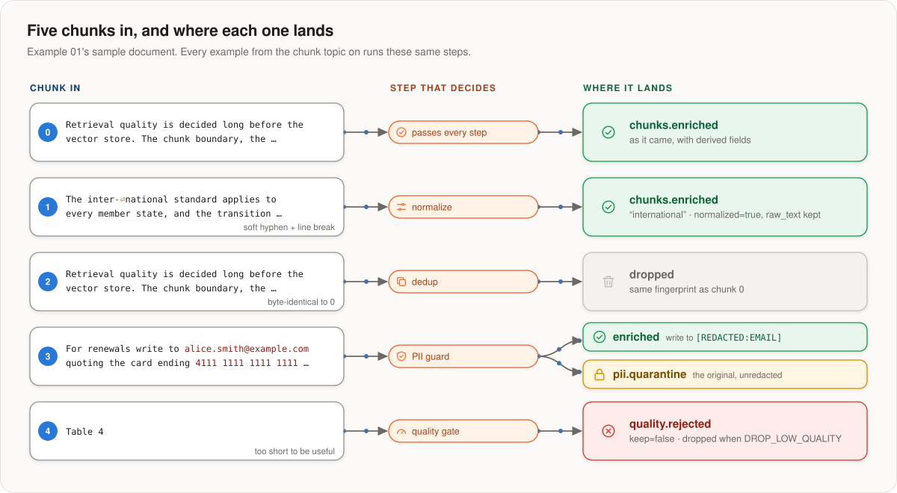

# The shared statements

The enrichment that examples 01–03 share: the chunk topic in, three topics
out. These files aren't copied into each example; `./setup.sh` and
`./pipeline.sh` merge them with the example's own `flink/` by file name, and
the number prefix sets the order. So for the same chunk, every example writes
the same record.

  

| files | what | run by |
|---|---|---|
| `00_table_*` | the enriched, quarantine and rejected tables | `./setup.sh apply` |
| `10_function_*` | the three Python UDFs, from the uploaded artifact | `./setup.sh apply` |
| `20_*`, `21_*` | the two views the pipeline is built from | `./pipeline.sh deploy` |
| `30_pipeline.sql` | chunks → prepare → guard → dedup, into three topics | `./pipeline.sh deploy` |
| `90_drop_view_*` | drop the views | `deploy`, `delete`, `destroy` |
| `91_drop_function_*` | drop a function before it is recreated | `apply`, `destroy` |
| `92_drop_table_*` | drop the tables — **and the topics, and their data** | `destroy --topics` |

- **`${NAME}` placeholders** are filled from the example's `env.sh` by
  `common/render.py`, which fails on a name it doesn't know. (`envsubst` would
  substitute an empty string, and you'd get a job reading a topic called `""`.)
- **An example can override a file** by putting one with the same name in its
  own `flink/`. None does today; keep it that way if you can.
- **Statement names:** files numbered `3*` are long-running and get a stable
  name (`$APP_NAME-<file>`), so `status` and `delete` can find them and a
  redeploy replaces them. The rest finish at once and get a timestamped name,
  because a statement name can't be reused.
