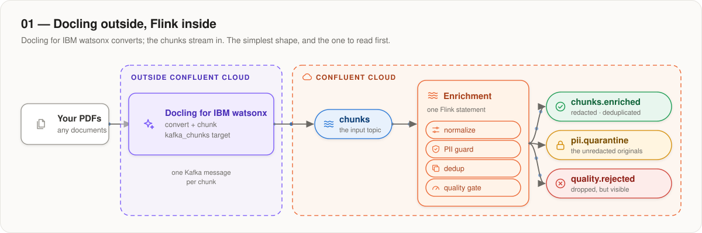
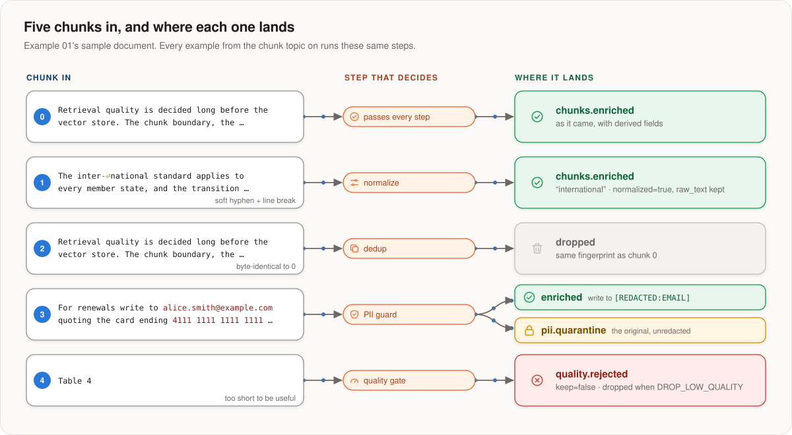

# 01 — Docling outside Flink

**Docling converts and chunks your documents outside Confluent Cloud, and
writes the chunks to a Kafka topic. One Flink statement cleans them up.**

<p align="center">
  
</p>

The simplest example, and the one to read first. Flink calls nothing outside
Confluent Cloud here: Docling's `kafka_chunks` target puts the chunks on the
topic, and the statement only transforms the stream. Examples 02 and 03 move
the conversion into Flink and keep everything after the chunk topic exactly
as it is here.

## Run it

After the [account setup](../../../docs/05-confluent-cloud/ACCOUNT.md):

```bash
./setup.sh info           # every name this example will use
./setup.sh apply          # the Python artifact, the tables (and topics), the functions
./pipeline.sh deploy      # the Flink statement
```

Send the sample document, then read the result (`<NS>` is the namespace value in `.env`):

```bash
uv run --project ../.. scripts/produce_chunks.py --sample
uv run --project ../.. ../../common/drain_topic.py --topic <NS>.ex01.chunks.enriched
```

**Run the scripts a second time if the first run returns 0 records.** The dedup only
emits once Flink's clock (the watermark) moves past a chunk, and the clock only
moves when new records arrive. The second batch pushes the first one through.
[`docs/05-confluent-cloud/LIMITS.md`](../../../docs/05-confluent-cloud/LIMITS.md#the-dedup-holds-rows-until-the-watermark-moves)
explains why, and how to trade this away. Quarantine shows its record at an instant.

| command | |
|---|---|
| `./pipeline.sh status` | is it running? |
| `./pipeline.sh sql '<statement>'` | run one SQL statement and print its rows — handy for debugging |
| `./pipeline.sh delete` | stop it (this stops the bill) |
| `./setup.sh destroy --dry-run` | show what a full teardown would remove |

## The sample document

`produce_chunks.py --sample` sends five chunks, one for each path through the
pipeline:

<p align="center">
  
</p>

The records have exactly the shape and ids Docling produces (they are built by
`docling_udf.chunk_record.build`), so the pipeline can't tell them apart.

## Using real Docling

Point Docling's `kafka_chunks` target at the topic `<NS>.ex01.chunks`. It is
the same target in Docling for IBM watsonx (as the `target` of
`/v1/convert/source`) and in `docling-jobkit` for a local run. It needs the
cluster's bootstrap servers and a Kafka API key — both are in `.env`.

If Docling creates the topic before you run `./setup.sh apply`, Confluent
Cloud infers a table for it and `CREATE TABLE` fails. Run
[`flink/00_alter_chunks.sql`](flink/00_alter_chunks.sql) instead: it adjusts
the inferred table so the pipeline can read it.

## What is in this folder

| | |
|---|---|
| `env.sh` | every name, derived from `NS` |
| `flink/00_table_chunks.sql` | the chunk topic — this example's only own table |
| `flink/00_alter_chunks.sql` | the alternative, when Docling created the topic first |
| `scripts/produce_chunks.py` | the five-chunk sample |

Everything else — the three output tables, the functions, the views and the
pipeline statement — comes from [`common/flink/`](../../common/flink/).
`./setup.sh` prints the path of each statement it runs, so you can see where
every file comes from.

The pipeline is one statement with three `INSERT`s (one per output topic).
There is no embedding step and no search-index sink:
[`docs/05-confluent-cloud/LIMITS.md`](../../../docs/05-confluent-cloud/LIMITS.md) explains what managed Flink can't run,
and what it would take to add them.
