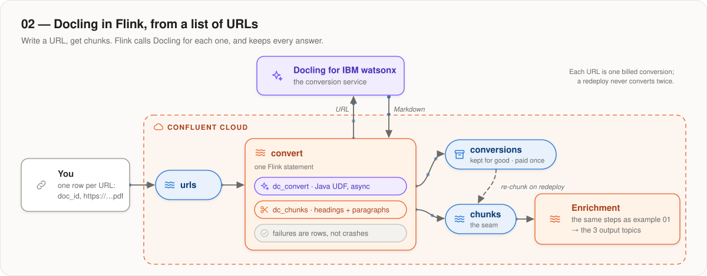
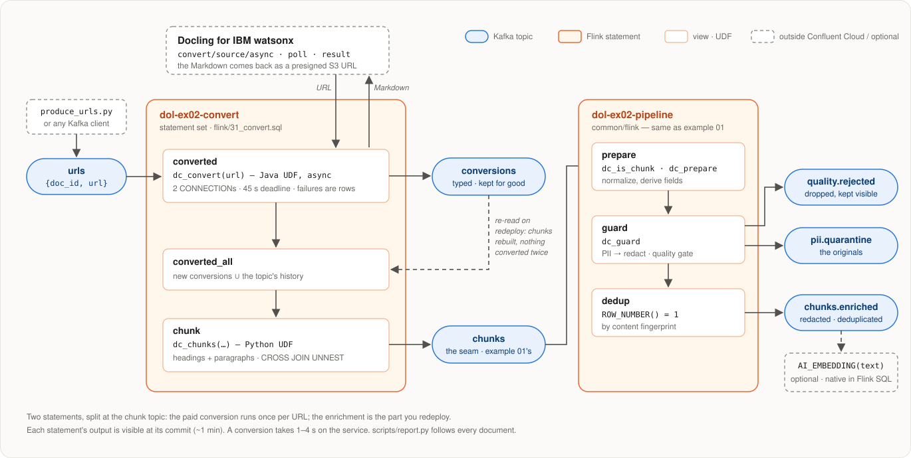

# 02 — Docling in Flink, from a list of URLs

**Write a URL to a topic. A Flink statement uses Docling for IBM watsonx to convert
it, keeps the result, and chunks it. Example 01's pipeline does the rest.**

<p align="center">
  
</p>

There are two Flink statements, split at the chunk topic:

- **convert** calls Docling for each URL. It is slow and every call is billed,
  so it rarely restarts.
- **pipeline** enriches the chunks. It is cheap, and it is the part you edit.
  These are the same files as in example 01 ([`common/flink/`](../../common/flink/)).

## Run it

After completing the [account setup](../../../docs/05-confluent-cloud/ACCOUNT.md), set
`DOCLING_SERVICE_URL` and `DOCLING_API_KEY` in `.env`. Then, here:

```bash
./setup.sh apply          # both artifacts (needs a JDK), connections, tables, functions
./pipeline.sh deploy
uv run --project ../.. scripts/produce_urls.py --sample
uv run --project ../.. scripts/report.py --watch
```

`--sample` sends three URLs of public papers, **where each URL is one billed conversion.**
`report.py` traces every document through the topics:

```
doc_id        conversion             s  chunks  enriched  quarantine  rejected
dummy         success · good       8.4       0         0           0         0
2206.01062    success · excellent  10.3      56        56           1         0
2408.09869    success · excellent  10.5      41        40           0         0
missing       failure              1.1       0         0           0         0   document status failure …
```

- A bad URL becomes a **failure row** but does not interrupt the statement.
- Conversions appear within a minute. Enriched chunks follow a few
  minutes later, once the dedup's
  [watermark moves](../../../docs/05-confluent-cloud/LIMITS.md#the-dedup-holds-rows-until-the-watermark-moves).
- The one chunk missing above is a duplicate: the second paper quotes a page
  of the first, and the dedup works across documents.

To send your own: `scripts/produce_urls.py --url https://…` (repeatable) or
`--file urls.txt`, one URL per line. To look inside a topic:
`uv run --project ../.. ../../common/drain_topic.py --topic <NS>.ex02.conversions --raw`.

## The topics

| topic | contains |
|---|---|
| `<NS>.ex02.urls` | what you write: one URL per record |
| `<NS>.ex02.conversions` | Docling's answer for every URL, failures included. Kept forever: it is the paid work |
| `<NS>.ex02.chunks` | chunk records, in example 01's format |
| `<NS>.ex02.chunks.enriched`, `.pii.quarantine`, `.quality.rejected` | the three outputs, as in example 01 |

## How it works

<p align="center">
  
</p>

**Nothing is converted twice.**
- `./pipeline.sh deploy` restarts only the statements whose SQL, views or
  functions changed. Edit a PII rule and only *pipeline* restarts.
- When *convert* does restart, it reads only new URLs, and rebuilds the chunks
  from the `conversions` topic. So a new chunker reaches every old document
  without paying for it again. To convert a URL again, send it again.

**The call to Docling is a Java UDF**
([`DoclingConvert`](../../common/udf-java/)), because Python UDFs in Confluent
Cloud can't open an HTTPS connection. It is asynchronous and answers within
45 s — with a failure row if it must — because Confluent Cloud fails the whole
statement when a call takes more than about a minute. A conversion usually
takes 1–4 s.

**Two connections.** A UDF can only reach a host that has a Confluent connection.
Docling for IBM watsonx returns the conversion result (Markdown) as a download link on S3,
so that host needs one connection. The UDF must also call the service on its own domain,
which needs a second connection.

**The chunking happens on Confluent.** Docling for IBM watsonx has no chunking endpoint, so
a Python UDF splits the Markdown on headings and packs paragraphs up to 1,200
characters. The records have the same format as example 01's.

## Limits

- A document that takes Docling more than 45 s becomes a failure row.
- The Markdown travels in one Kafka record (about 5 KB per page, 2 MB limit),
  so very long documents don't fit.
- For volume, convert in batches *outside* Flink with
  `POST /v1/convert/source/batch` and the `kafka_chunks` target — that is
  example 01's shape.
- No embeddings yet. Flink SQL can compute them with `AI_EMBEDDING`; see
  [`docs/05-confluent-cloud/LIMITS.md`](../../../docs/05-confluent-cloud/LIMITS.md#embedding-not-in-these-pipelines).

## Self-hosted docling-serve

Set `DOCLING_SERVICE_URL` to any publicly reachable docling-serve and leave
`DOCLING_API_KEY` empty if it needs none. If it returns results in the
response body, the S3 connection isn't used; otherwise set
`DOWNLOAD_ENDPOINT` to the S3 region the service signs its links in
(`us-east-1` for Docling for IBM watsonx).

## What is in this folder

| | |
|---|---|
| `env.sh` | every name, derived from `NS` |
| `flink/00_table_*.sql` | the `urls`, `conversions` and `chunks` tables |
| `flink/05_connection_*.sql` | the Docling and S3 connections |
| `flink/10_function_*.sql` | `dc_convert` (Java) and `dc_chunks` (Python) |
| `flink/22_view_converted.sql` | new URLs through `dc_convert` |
| `flink/23_view_converted_all.sql` | …plus the conversions already on the topic |
| `flink/31_convert.sql` | the *convert* statement |
| `scripts/produce_urls.py`, `report.py` | send URLs; follow them through |
| `pipeline.svg` | the detailed diagram, drawn by hand — update it when the SQL changes |
