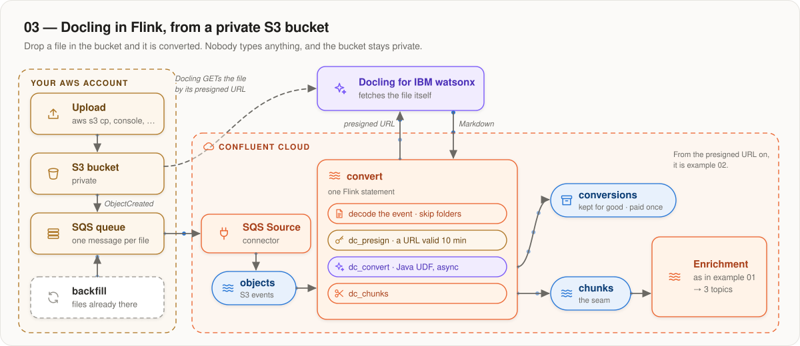
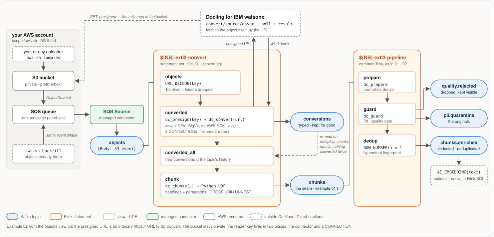

# 03 — Docling in Flink, from a private S3 bucket

**Upload a file to S3 and it gets converted. A managed Confluent connector
turns each upload into a record, Flink signs a temporary link to the file, and
Docling for IBM watsonx converts it from there. Example 01's pipeline does the
rest.**

<p align="center">
  
</p>

This is [example 02](../02-docling-in-flink-urls/) with a different way in:
instead of typing URLs, you drop files in a private bucket. Nobody else can
read the bucket, and nothing in Confluent Cloud reads it either — only Docling
does, through a link that expires after 10 minutes.

## Run it

After the [account setup](../../README.md#quick-start), set
`DOCLING_SERVICE_URL` and `DOCLING_API_KEY` in `.env`. You also need the AWS
CLI, signed in to an account where you can create a bucket, a queue and an
IAM user. Then, here:

```bash
scripts/aws.sh create             # bucket, SQS queue, notification, a read-only IAM user
scripts/aws.sh check
./setup.sh apply                  # artifacts, 3 connections, tables, functions, the connector
./pipeline.sh deploy
scripts/aws.sh samples            # upload three public PDFs
uv run --project ../.. scripts/report.py --watch
```

**Each file is one billed conversion.** `report.py` follows every file through
the topics:

```
key                      via       conversion             s  chunks  enriched  quarantine  rejected
inbox/dummy.pdf          s3        success · good       2.4       1         1           0         0
inbox/2206.01062.pdf     s3        success · excellent  9.9      56        56           1         0
inbox/old/contract.pdf   backfill  success · good       4.1      12        12           0         0
```

**Files that were in the bucket before** don't trigger a notification. Send
them with `scripts/aws.sh backfill --dry-run`, then without `--dry-run`, after
`deploy`.

[`AWS.md`](AWS.md) covers the AWS side in full: what `aws.sh` creates, doing it
by hand, using a bucket you already have, costs, and troubleshooting.

## The topics

| topic | contains |
|---|---|
| `<NS>.ex03.objects` | one record per S3 notification, written by the connector |
| `<NS>.ex03.conversions` | Docling's answer for every file, failures included. Kept forever: it is the paid work |
| `<NS>.ex03.chunks` | chunk records, in example 01's format |
| `<NS>.ex03.chunks.enriched`, `.pii.quarantine`, `.quality.rejected` | the three outputs, as in example 01 |

## How it works

<p align="center">
  
</p>

**The bucket becomes a topic through SQS.** S3 sends a notification to an SQS
queue for every new file, and Confluent's managed **SQS Source** connector
writes each one to the `objects` topic. (Confluent's S3 Source connector
doesn't fit: it reads file *contents*, line by line, and can't list a bucket.)

**The backfill uses the same queue.** [`scripts/backfill.py`](scripts/backfill.py)
lists the bucket and sends each older file to the queue as an S3-style event,
so the connector and Flink treat it exactly like an upload. It only sends files
older than the notification, so nothing arrives twice.

**One row per upload.** [`flink/22_view_objects.sql`](flink/22_view_objects.sql)
decodes the file name from the event and drops test events and folders.

**`dc_presign` makes a link Docling can open.** A Java UDF
([`S3Presign`](../../common/udf-java/src/main/java/ai/docling/confluent/S3Presign.java))
computes an AWS presigned URL from the file name, the clock and the IAM user's
key — locally, with no call to AWS. The key is stored in a Flink connection.

**From there it is example 02**: `dc_convert` gets an ordinary `https://` URL.
A restart reads only new uploads and rebuilds the chunks from `conversions`,
so nothing is converted twice. [Example 02](../02-docling-in-flink-urls/README.md#how-it-works)
explains the Docling call.

## Limits

Example 02's limits apply: 45 s per conversion, and the Markdown must fit in
one Kafka record. Also:

- **A notification delivered twice is converted twice.** SQS can deliver
  twice, and so does running the backfill twice. The dedup removes the
  repeated chunks, but each conversion is billed.
- **Uploads while *convert* isn't deployed are skipped**, because a deploy
  reads only new records. Send them again afterwards with
  `scripts/aws.sh backfill --since <when it stopped>`.
- **For volume, convert in batches outside Flink:** Docling's
  `POST /v1/convert/source/batch` can read from S3 itself and write chunks with
  the `kafka_chunks` target — example 01's shape, triggered by this same topic.

## Cleaning up

**The connector bills by the hour** and keeps running after
`./pipeline.sh delete`. `./setup.sh destroy` removes it. Then remove the AWS
side ([details](AWS.md#tearing-it-down)):

```bash
./setup.sh destroy --dry-run
./setup.sh destroy
scripts/aws.sh destroy            # add --bucket to delete the bucket too, if the script created it
```

## What is in this folder

| | |
|---|---|
| `AWS.md`, `scripts/aws.sh` | the AWS side: what, why, and the script that does it |
| `env.sh` | every name, derived from `NS`; `PRESIGN_TTL` (600 s) |
| `terraform/main.tf` | the shared setup, plus the SQS Source connector |
| `flink/00_table_*.sql` | the `objects`, `conversions` and `chunks` tables |
| `flink/05_connection_*.sql` | Docling, its download host, the bucket |
| `flink/10_function_*.sql` | `dc_presign`, `dc_convert` (Java), `dc_chunks` (Python) |
| `flink/22_view_objects.sql` | S3 events → one row per upload |
| `flink/23_view_converted.sql` | presign and convert each new upload |
| `flink/24_view_converted_all.sql` | …plus the conversions already on the topic |
| `flink/31_convert.sql` | the *convert* statement |
| `scripts/backfill.py`, `report.py` | send older files; follow files through |
| `pipeline.svg` | the detailed diagram, drawn by hand — update it when the SQL changes |
