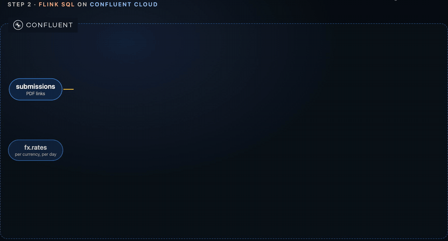
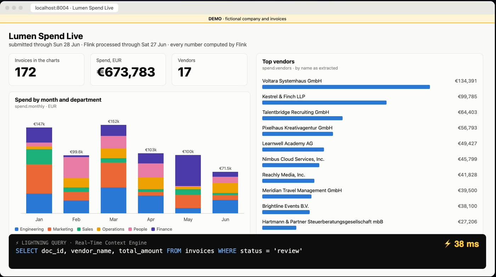
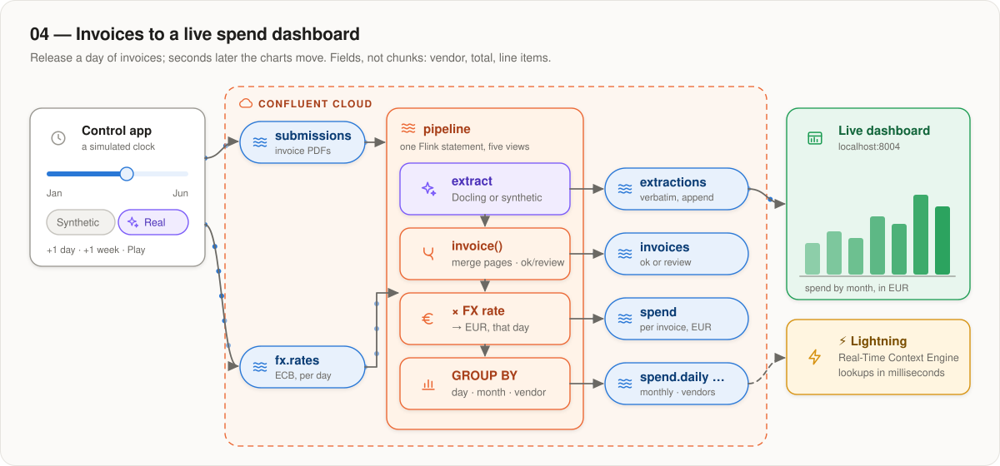
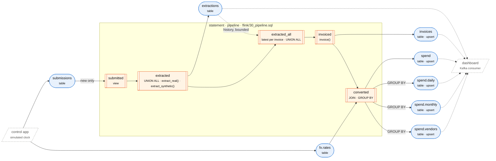

# 04 — Invoices to a live spend dashboard

> **Demo.** Lumen Analytics GmbH, its suppliers and every invoice here are
> fictional, generated for this example; every PDF page says so.

**Six months of a company's supplier invoices, replayed as fast as you like.
Flink extracts the vendor, total and line items from each PDF, converts them to
EUR at that day's exchange rate, and keeps the reports a live dashboard shows.**

<p align="center">
  <a href="video/ex04-docling-confluent.mp4"></a>
  <br><sub>From the <a href="video/ex04-docling-confluent.mp4">one-minute demo video</a></sub>
</p>

Unlike examples 01–03, this example extracts **fields, not chunks**, so it doesn't
use the shared enrichment. Each invoice is extracted one of two ways, chosen
when you release it:

- **Real** — Docling for IBM watsonx's structured extraction reads the PDF.
- **Synthetic** — a Python UDF answers from the invoice's known contents, in
  the same format as Docling. Free and instant; good for trying the pipeline.

> [!WARNING]
> **Field extraction is experimental and not yet generally available.** It
> follows the extraction API of an unmerged Docling pull request,
> [docling-project/docling#4218](https://github.com/docling-project/docling/pull/4218),
> and the scripts that run it from your machine (`--group extract`) install the
> Docling client from that pull request's branch. Until it is merged and
> released, the API can change and the branch can change or disappear, which
> would stop `--group extract` from installing. The *synthetic* mode and the
> rest of the pipeline don't depend on the client.

## Run it

From `05-confluent-cloud/`, once: set `GLOBAL_KEY="yes"` in `.env` (lightning queries
need a *global* API key), then `./account.sh apply` and `./account.sh check`.

The invoice PDFs are not in this repository, and the dashboard's previews read
them from `data/invoices/`. Download them once from the public Hugging Face
bucket, from this folder:

```bash
uvx --from 'huggingface-hub>=1.0' hf buckets sync \
  hf://buckets/docling-project/docling-confluent-ex04/invoices data/invoices
```

Then, here:

```bash
./setup.sh info                # every name this example will use
./setup.sh apply               # 2 artifacts, 2 connections, 8 tables, 3 functions
./pipeline.sh deploy           # the statement, then the first 3 days (21 invoices)
./setup.sh context-engine on   # optional and billed: lightning queries (~10 min to start)
uv run --project ../.. --group control scripts/control.py serve
```

Open <http://localhost:8004>:

<p align="center">
  
</p>

- **Release days** with the slider, **+1 day**, **+1 week** or **Play**, and
  choose **Synthetic** or **Real** beside them. Real needs a Hugging Face token
  that can read `INVOICE_BUCKET` (`HF_TOKEN` or `hf auth login`).
- **Tabs:** *Dashboard* (each panel's **SQL** button shows the statement behind
  it), *Flink pipeline* (the live graph), *Inputs* (any invoice, stage by
  stage), *⚡ Lightning queries*, *About the data*.

From the command line instead:

```bash
uv run --project ../.. scripts/control.py status
uv run --project ../.. scripts/control.py advance --days 7
uv run --project ../.. scripts/control.py advance --days 1 --mode real
./pipeline.sh status
```

**To start over**, stop the control app, run `./setup.sh destroy --topics`
(it deletes the data, and asks first), then the commands above.

## How it works

<p align="center">
  
</p>

One Flink statement ([`flink/30_pipeline.sql`](flink/30_pipeline.sql)) does
everything, through five views:

1. **extract** — each new submission goes to `extract_real()` (Docling) or
   `extract_synthetic()`. Both answer in Docling's format; the answer is
   written to `extractions` as is.
2. **invoice()** — merges the pages into one invoice and marks it `ok`, or
   `review` with the reasons.
3. **× FX rate** — joins the ECB rate of the invoice date and converts to EUR.
4. **GROUP BY** — keeps the daily, monthly and per-vendor reports.

<details>
<summary><b>The full graph</b>, generated from the SQL</summary>

<!-- pipeline-diagram:begin — generated by scripts/diagram.py; edit the SQL, not this -->



<!-- pipeline-diagram:end -->

`scripts/diagram.py` generates it from `flink/`, the same graph the dashboard
shows; `uv run pytest` in `udf/` fails when it is out of date.

</details>

- **From release to charts in under a minute.** Every table is written at the
  same Flink checkpoint, about once a minute (26 s measured). A real
  extraction adds 7–15 s per page.
- **A redeploy extracts nothing twice.** `./pipeline.sh deploy` only replaces
  the statement when its SQL, views or functions changed. The new statement
  reads only new submissions, and rebuilds the reports from `extractions`.
- **Each invoice counts once.** The reports use the latest extraction per
  invoice and one rate per day, and they are upsert tables, so a rebuild
  overwrites them.
- **The cost of a single statement:** a failure restarts all of it, and
  repeats any real extraction in flight. That is why `DoclingExtract` always
  answers within 45 s — a slow invoice becomes a `review` row instead of
  failing the statement.

| table | contains |
|---|---|
| `<NS>.ex04.submissions` | input: one row per invoice — `doc_id, url, department, category, submitted_at, mode` |
| `<NS>.ex04.fx.rates` | input: the ECB rate per currency per day |
| `<NS>.ex04.extractions` | every extraction answer, verbatim, failures included |
| `<NS>.ex04.invoices` | one typed row per invoice; `status` is `ok` or `review`, with `review_reasons` |
| `<NS>.ex04.spend` | each `ok` invoice, in EUR |
| `<NS>.ex04.spend.daily`, `.monthly`, `.vendors` | the reports |

Every topic has a registered JSON Schema; Flink creates them all with
`CREATE TABLE`.

## Real extraction

| mode | function | |
|---|---|---|
| `synthetic` | `<NS>_ex04_extract_synthetic` | Python, in [`udf/`](udf/): answers from the ground truth |
| `real` | `<NS>_ex04_extract_real` | Java, `DoclingExtract` in [`common/udf-java`](../../common/udf-java/): Docling's [structured extraction](https://github.com/docling-project/docling/pull/4218) |

**The PDFs** are in a Hugging Face bucket (`INVOICE_BUCKET`). The
control app gives each real invoice a signed URL, valid for an hour, when it
releases it, so your token never leaves your machine. Real invoices go out 3 s
apart, so Docling gets a steady trickle.

**What to extract** is a literal in
[`flink/20_view_submitted.sql`](flink/20_view_submitted.sql): a JSON Schema for
an `Invoice` with `LineItem`s, an example answer, and one line of
instructions. Edit it and redeploy. Docling's answers need some help, which
`invoice()` gives:

- one result per page: header fields come from the first page that has them,
  totals from the last, line items from all;
- dates come back as printed (`20.02.2026`, `30 December 2025`), not as the
  schema asks, so they are parsed — month first on USD invoices;
- a page that doesn't match the schema has its answer only in `raw_text`, so
  it is read from there;
- a page the model never answered sends the invoice to review
  (`pages_not_extracted`).

### How accurate it is

Run the same extraction and scoring from your machine, without Flink:

```bash
uv run --project ../.. --group extract scripts/extract.py run --sample 10
uv run --project ../.. --group extract scripts/extract.py score
```

All 174 invoices, on 2026-10-05:

| | n | ok | vendor | number | date | total | lines |
|---|---|---|---|---|---|---|---|
| all | 174 | 159 | 85% | 100% | 95% | 100% | 95% |
| single-page | 166 | 159 | 84% | 100% | 99% | 100% | 100% |
| multi-page | 8 | 0 | 100% | 100% | 0% | 100% | 0% |

Totals and invoice numbers are always right. Vendor names miss where the model
"corrects" them (`Volterra` for `Voltara`). Every two-page invoice goes to
review: its first page has 20+ line items, and the model server gives up on it
after 20 s.

`scripts/dataset.py publish` turns the bucket into an evaluation set: a dataset
card, the ground truth, the target and each scored run.

## The data

- **Lumen Analytics GmbH**, Munich: six departments, seven expense categories.
- **17 suppliers, 174 invoices**, 5 January to 29 June 2026, in EUR, USD, GBP
  and CHF — with a story the charts show: a sales kickoff in Lisbon, a trade
  fair, a hiring wave, a financing round, a growing cloud bill.
- **Seven layouts**: German DIN letters, a US SaaS bill, an EU reverse-charge
  invoice, a UK fee note, a Swiss QR invoice, a Portuguese hotel folio. Eight
  invoices have two pages; ten are scans with no text layer.
- **Real exchange rates**: ECB reference rates, November 2025 to June 2026
  (`data/ecb_rates.csv`).

`data/manifest.jsonl` holds, per invoice, what the employee submits and the
`truth` printed on it. Regenerate everything, deterministically, with
`uv run --project ../.. --group invoices scripts/generate.py`.

## Simulated time

Nothing runs on the wall clock. The control app releases one simulated day at a
time — its exchange rates, then its invoices — and gives each record its
simulated time as the Kafka timestamp, which Flink uses as its clock. That is
why every topic here has one partition (the clock is the topic's order) and
infinite retention (the records are "months old"). The app reads the clock back
from the topics, so it keeps no state of its own.

## Lightning queries

The Real-Time Context Engine keeps a copy of `extractions`, `invoices`,
`spend`, `spend.monthly` and `spend.vendors` and answers lookups in
milliseconds — no aggregates or joins, at most 200 rows. The page uses it for
the ⚡ tab and the invoice trace, through the engine's MCP endpoint
(`scripts/lightning.py`). It needs the global API key (`RTCE_API_KEY` in
`.env`), runs on AWS only, and is billed while on: turn it off with
`./setup.sh context-engine off`. Column names come back upper-cased.

## What is in this folder

| | |
|---|---|
| `env.sh` | every name, derived from `NS`; one partition, infinite retention |
| `flink/` | 8 tables, 2 connections, 3 functions, 5 views, the statement |
| `pipeline.sh`, `scripts/deploy_plan.py` | deploy only the statements that changed |
| `udf/` | the Python artifact: the synthetic extraction and `invoice()`, with tests |
| `scripts/control.py`, `simclock.py`, `dashboard.py`, `static/` | the clock and the page |
| `scripts/sources.py`, `extract.py`, `dataset.py` | signed URLs, extraction from your machine, the dataset |
| `scripts/diagram.py`, `pipeline_info.py`, `lightning.py`, `sr.py` | the graph, live state, lightning queries, Schema Registry |
| `scripts/company.py`, `invoice_pdf.py`, `generate.py`, `data/` | the data generator and its output |
