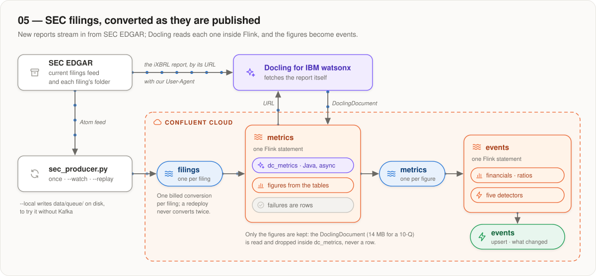
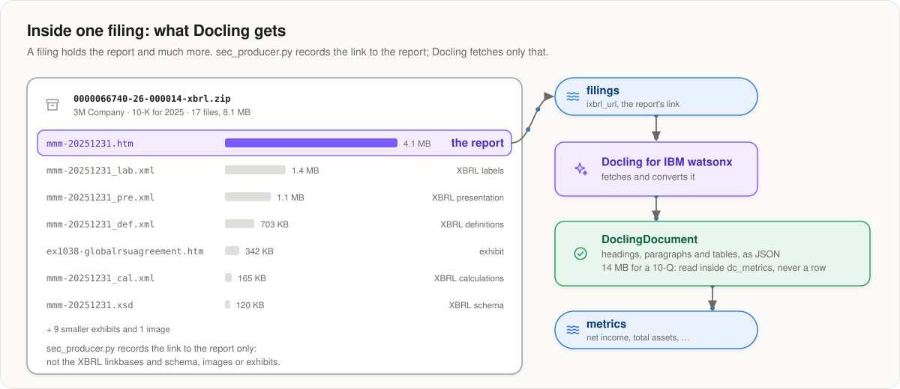

# 05 — SEC filings, converted as they are published

**Companies' annual and quarterly reports arrive on SEC EDGAR as they are
filed. This example streams each new filing into Kafka, has Docling for IBM
watsonx convert the report from inside a Flink statement, and keeps the
headline figures. A second statement turns those into a feed of financial
events.**

<p align="center">
  
</p>

Like [example 02](../02-docling-in-flink-urls/), a topic of inputs and a Flink
statement that calls Docling for IBM watsonx through a connection. Unlike
examples 01–03 it extracts **figures, not chunks**, so it doesn't use the
shared enrichment. And it keeps only the figures: the converted document of a
10-Q is 14 MB, and a Confluent Cloud row is 4 MB.

## Run it

After the [account setup](../../README.md#quick-start), set
`DOCLING_SERVICE_URL` and `DOCLING_API_KEY` in `.env`. The environment needs
Stream Governance on, for its Schema Registry, and you need a JDK to build the
Java UDF. SEC EDGAR asks every client to identify itself (its
[Fair Access Policy](https://www.sec.gov/os/webmaster-faq#developers)), so also
set `SEC_USER_AGENT="Your Name you@example.com"` in `.env`, or pass
`--user-agent` to the producer. Then, here:

```bash
./setup.sh info           # every name this example will use
./setup.sh apply          # the Java artifact, 2 connections, 3 tables (and topics), the function
./pipeline.sh deploy      # the two Flink statements
uv run --project ../.. scripts/sec_producer.py --form 10-K,10-Q --limit 5
uv run --project ../.. scripts/report.py --watch --metrics
```

**Produce filings after `deploy`.** The metrics statement reads the filings
topic from where it ends when it is deployed, so a filing produced before is
never converted. **Each filing is one billed conversion.** `report.py` follows
every filing through the topics:

```
    filing                          form    result      metrics
    OPENLANE, Inc.                  10-Q    ok               11
    City Holding Co                 10-Q    ok               11
    Some Bank                       10-K    failed            0   GET /v1/result/… answered HTTP 403
    Some Trust                      10-K    no figures        0   no statement with a known row label
```

A filing shows as *waiting* until its figures are on the topic: conversions
take 3–5 s for a small filing and longer for the biggest ones, and Flink makes
rows visible at its checkpoint, about once a minute. A filing with no inline
XBRL report (an older one) is skipped by the statement, so it waits for good.

### Ways to produce filings

`sec_producer.py` has three modes. Each writes the same record to
`<NS>.ex05.filings`.

**One-shot (default)** produces the latest `--limit` filings (default 5) and
exits:

```bash
uv run --project ../.. scripts/sec_producer.py --form 10-K,10-Q --limit 5
```

**Continuous: `--watch`** polls the feed every `--interval` seconds (default
60) and produces each new filing once, until you press Ctrl-C. Query the Flink
statements in streaming mode to see rows arrive:

```bash
uv run --project ../.. scripts/sec_producer.py --watch --form 10-K,10-Q
uv run --project ../.. scripts/sec_producer.py --watch --interval 300
```

The first poll produces the filings currently in the feed; later polls produce
only filings not seen yet. With `--watch`, `--limit` caps each poll (default:
no cap). The set of seen filings is kept in memory, so a restart produces the
current feed again.

**Reproducible demo: `--replay`** skips the SEC entirely and produces the
filing records saved in `data/queue/` (or any directory you pass), sorted by
file name, so every run sends the same data:

```bash
uv run --project ../.. scripts/sec_producer.py --replay                 # all saved records
uv run --project ../.. scripts/sec_producer.py --replay --limit 1       # first one only
uv run --project ../.. scripts/sec_producer.py --replay --form 10-Q     # only saved 10-Qs
uv run --project ../.. scripts/sec_producer.py --replay path/to/dir     # another directory
```

**Without Kafka:** `--local` writes the records to `data/queue/` instead of
the topic, which is how the replay set is made:

```bash
uv run --project ../.. scripts/sec_producer.py --local --form 10-K --limit 3
```

| command | |
|---|---|
| `./pipeline.sh status` | are the statements running? |
| `./pipeline.sh sql '<statement>'` | run one SQL statement and print its rows |
| `./pipeline.sh delete` | stop them (this stops the bill) |
| `./setup.sh destroy --dry-run` | show what a full teardown would remove |

## What Docling gets from a filing

Each filing on SEC EDGAR is a folder: the report as inline XBRL (an `.htm`
file with the XBRL tags inside the HTML, the one a person reads on sec.gov),
the XBRL instance, the taxonomy files, exhibits, and a bulk ZIP of it all.
`sec_producer.py` reads the folder's `index.json` and records the link to the
report, in `ixbrl_url`: the `.htm` that the instance `<name>_htm.xml` was
extracted from, or else the largest `.htm` that is not an exhibit.

<p align="center">
  
</p>

Docling for IBM watsonx fetches the report **itself**, with the `User-Agent` the
statement passes it (`SEC_USER_AGENT`; the SEC answers 403 without one) and
converts it as HTML: it can't be given a taxonomy to read the tags with. So no
6 MB report ever passes through Flink, and there is no connection to sec.gov.

## The pipeline

<p align="center">
  
</p>

One Flink statement, [`flink/31_metrics.sql`](flink/31_metrics.sql), takes each
new filing to its figures:

```
filings ──▶ dc_metrics ──▶ UNNEST ──▶ metrics
            Docling converts the iXBRL report; the figures are read from the
            tables of the DoclingDocument
```

`UNNEST` is the SQL step that turns an array into rows. `dc_metrics` is a scalar
function, so it answers each filing with one value: an array holding one JSON
object per figure. `CROSS JOIN UNNEST` then makes one row of each element, and
that is what lands in the `metrics` topic: one row per figure per filing.

`dc_metrics` ([`DoclingMetrics.java`](udf/src/main/java/ai/docling/confluent/xbrl/DoclingMetrics.java), in [`udf/`](udf/))
converts the filing and reads it in one call. The converted document is **not
stored**, and it is not `dc_convert` either: a 10-Q's DoclingDocument is 14 MB
of JSON, a Confluent Cloud UDF row is 4 MB in and out (a platform limit), so the
document cannot be a value in SQL. It is downloaded, read and dropped inside the
function, and only the figures leave. The price is that a filing is read again
only by producing it again, and paying for it again.

The figures come from the statements' tables, found by the label of the row
(`Total assets`, `Net loss`, …). There is no common data model for these
tables across companies, so this is a best effort for illustration:
revenue, gross profit, operating income, net income, total (current) assets
and liabilities, stockholders' equity, cash, and operating cash flow, with the
period before it and the scale (`in thousands`) the statement states. A filing
that gave none is a row too, with `metric` set to `conversion_failed` or
`no_figures_found` and the reason in `label`.

`prior_value` is the next figure of the row, and `prior_column` says which period
that is, in the words of the table's head: a 10-Q's balance sheet compares with
the last year-end (`December 31, 2025`), its income statement with the same
quarter of last year (`Three Months Ended September 30, 2025`). `value_column`
is the same for `metric_value`.

**Nothing is converted twice.**
- `./pipeline.sh deploy` replaces only the statements whose SQL, views,
  functions or thresholds changed. A replaced metrics statement reads only the
  filings produced from then on.
- Filings produced while the statement is not deployed are skipped. Produce them
  again afterwards.

**The call to Docling is a Java UDF**, because Python UDFs in Confluent Cloud
can't open an HTTPS connection. It is asynchronous and answers within 45 s —
with a `conversion_failed` row if it must — because Confluent Cloud fails the
whole statement when a call takes more than about a minute.

**Two connections**, as in example 02: one for the Docling service (with the API
key) and one for the S3 host it answers from, with a presigned URL.

## Events: what changed in a filing

A second statement, [`flink/32_events.sql`](flink/32_events.sql), turns the
metrics into a live feed of financial events. It does not call Docling: it reads
the metrics topic, so it costs nothing to change and redeploy.

```
metrics ──▶ financials ──▶ five detectors ──▶ events
            one row per filing,             (upsert)
            in dollars, with ratios
```

[`flink/23_view_financials.sql`](flink/23_view_financials.sql) keeps the latest
row per filing and metric (a filing produced twice is not counted twice), leaves
out the failure rows, multiplies every figure by its `scale` so they are
dollars, pivots the rows of a filing into columns, and computes revenue growth,
gross and net margin, the growth of costs and of net income, the change of cash,
leverage (`total_liabilities / stockholders_equity`) and the current ratio. A
ratio is NULL, not 0, when an input is missing.

The five events, each compared with the period beside it in the same statement:

| `event_type` | fires when | severity |
|---|---|---|
| `net_income_negative` | net income was positive and is a loss now | high |
| `operating_cash_flow_negative` | the same, for cash from operating activities | high |
| `gross_margin_compression` | gross margin fell by 2 points or more | medium; high from 5 points |
| `costs_outpacing_revenue` | operating costs grew 1 point or more faster than revenue, and grew | medium; high from 5 points |
| `cash_drop` | cash fell by 30 % or more | medium; high from 50 % |

Operating costs are revenue less operating income, a proxy for operating
expenses, which are not read separately. The thresholds are `EVENT_*` in
[`env.sh`](env.sh); changing one and running `./pipeline.sh deploy` replaces only
the events statement and derives every event again from the metrics already read.

Every event is a row with its sentence and the two periods compared:

```
Seres Therapeutics, Inc.  cash_drop  high
  Cash fell sharply: $17.5M from $45.8M (-61.7%) [September 30, 2026 vs December 31, 2025]
```

**Read the comparison before the event.** A cash drop against the last year-end
is a different thing from a drop against last quarter, and the `comparison`
column says which one it is. A company that reports a column in an unusual
layout may be read wrongly: every figure has its `table_ref` to check.

**Banks, BDCs and trusts have fewer events.** They have no revenue or gross
profit, so the margin and cost events can never fire for them; only net income,
operating cash flow and cash apply. An absent event for such a company says
nothing about it.

To look at the events, in the Confluent Cloud SQL workspace:

```sql
SELECT company_name, form, event_type, severity, description FROM `<NS>.ex05.events`;
```

The result table charts each column as a distribution, so the spread of event
types and severities is one click away. Confluent Cloud has no saved dashboards
for Flink output.

Or, with no Flink statement and nothing billed, a plain Kafka reader that shows
the topic as the table it stands for (the last record of each key, high severity
first, newest filing first):

```bash
uv run --project ../.. scripts/report.py --events --watch
```

## The topics

| topic | contains |
|---|---|
| `<NS>.ex05.filings` | what `sec_producer.py` writes: one typed `json-registry` record per filing — company, CIK, form, accession number, filing date, the link to the iXBRL report (`ixbrl_url`), the XBRL instance and taxonomy file links, and the bulk XBRL ZIP URL |
| `<NS>.ex05.metrics` | one typed record per figure per filing: `metric`, `label`, `metric_value`, `prior_value`, `value_column`, `prior_column`, `scale`, `period_end`, and the table it was read from. Failures included |
| `<NS>.ex05.events` | upsert, compacted, one record per filing and event: `event_type`, `severity`, a `description`, the values compared and the `comparison` periods |

A filing record matches the structure in [`data/queue/0000899394_000089939426000033.json`](data/queue/0000899394_000089939426000033.json).
Every topic has a registered JSON Schema; Flink creates them all with
`CREATE TABLE`.

## Limits

- A filing that takes Docling more than 45 s becomes a `conversion_failed` row,
  not a failed statement. The biggest filings (about 6 MB) are the ones at risk.
- Only the figures are kept, so an improved `dc_metrics` reaches only the
  filings produced after it.
- The figures are read by the label of a table row: a best effort, not an
  XBRL-aware extraction.
- Filings with no inline XBRL report are skipped.
- Rows written to Kafka become visible at the statement's checkpoint, about
  once a minute.

## What is in this folder

| | |
|---|---|
| `pipeline.svg` | the detailed diagram, drawn by hand — update it when the SQL changes |
| `env.sh` | every name, derived from `NS`; `SEC_USER_AGENT`, `SEC_FORM_TYPE`, the `EVENT_*` thresholds |
| `setup.sh`, `pipeline.sh` | Terraform runner (`info`, `plan`, `apply`, `tf`, `destroy`); the deploy of the two statements (`deploy`, `status`, `sql`, `delete`) |
| `terraform/` | Terraform definition calling shared `terraform/modules/example` |
| `flink/00_table_*.sql` | typed Flink table definitions (`filings`, `metrics`, `events`) |
| `flink/05_connection_*.sql` | Docling service and artifact download connections |
| `flink/10_function_metrics.sql` | `dc_metrics`: converts a filing and reads its figures |
| `flink/22_view_extracted.sql`, `flink/31_metrics.sql` | the view that calls it, and the statement that unnests its figures into the metrics topic |
| `flink/23_view_financials.sql`, `flink/32_events.sql` | one row per filing with its ratios, and the statement that detects the events from it |
| `udf/` | the Java artifact: `dc_metrics` and the Docling calls behind it, with tests (`./build.sh test`) |
| `scripts/sec_producer.py` | polls SEC EDGAR Atom feed (once, `--watch`, or `--replay`); produces filing records to Kafka or `data/queue/` |
| `scripts/report.py` | one line per filing: waiting, ok, failed or no figures; `--events` lists the events instead |
| `scripts/sr.py` | Schema Registry framing for the topics |
| `scripts/download_xbrl.py` | downloads sample XBRL ZIPs into `data/<ticker>/`, which are not committed; the pipeline does not use them |
| `data/queue/` | filing records written in `--local` mode; replayed by `--replay` |

The overview diagrams are drawn by [`docs/05-confluent-cloud/diagrams/draw_ex05.py`](../../../docs/05-confluent-cloud/diagrams/draw_ex05.py);
`pipeline.svg` is drawn by hand.
